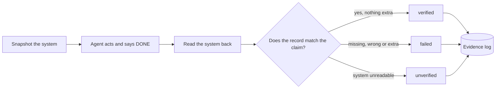

# Readback

[](https://github.com/dhonitheja/agent-readback/actions/workflows/tests.yml)

Check what an AI agent says it did against the system of record.

An agent that books an appointment, issues a refund or updates a row usually
ends with "Done." That message is a claim. Readback treats it as one: it
snapshots the real system before the agent acts, reads it again afterward
through a path the agent cannot write to, and returns a verdict.

| Verdict | Meaning |
|---|---|
| `verified` | The system shows exactly what was claimed, with nothing extra. |
| `failed` | The effect is missing, a field is wrong, or something unclaimed also changed. |
| `unverified` | The check could not run. Treat it as an open item, never as success. |

Verdicts never come from an LLM; every check is a deterministic comparison.



| Problem | Example | Finding |
|---|---|---|
| The write never landed | API answered 201, nothing was stored | `missing` |
| A field is wrong | Appointment saved a day late, refund for the wrong amount | `wrong_value` |
| Something extra happened | Duplicate booking, double refund, unclaimed extra row | `extra_effect` |
| The check could not run | System of record was down | `unreachable` |

## What is tested and what is not

Version 0.2.2. All 119 offline tests pass with the optional test dependencies
installed. A separate public HAPI FHIR R4
sandbox run verified 10 scripted operations (6 bookings, 1 reschedule,
3 cancellations); this is a compatibility smoke test, not production validation.
A Stripe test-mode run produced the expected verdict for all four refund
scenarios, using a separate restricted key that was confirmed unable to
create refunds.

| Part | Tested against | Not yet tested against |
|---|---|---|
| FHIR appointment verifier (create, update, cancel) | in-memory mock, incomplete pagination, stale-search regression, off-server next links; public HAPI R4 sandbox smoke test | a production EHR, authenticated read-only isolation |
| Stripe refund verifier and sandbox runner | mock refunds endpoint; test-key guards; Stripe test mode with a read-only restricted key: success, missing, wrong-amount and duplicate scenarios | live mode, a refund left pending by the bank |
| SQL row verifier | SQLite, including insert with concurrent deletion | Postgres or any other database |
| Anthropic and OpenAI-compatible agent loops | Mock responses cover each API's message format, Responses tool-call chaining with and without storage, and a once-per-evaluation warning for a model HTTP 400. Earlier live Anthropic runs (claude-sonnet-5-5 and claude-haiku-5-5, 50 tasks each, 20% injected faults) caught every false completion and matched the scripted baseline run for run. On the same tasks and faults, gpt-6-luna with `--reasoning-effort none` caught all 13 injected faults plus 6 of its own wrong reschedule or cancel values. With `--provider openai-responses --reasoning-effort medium`, it caught all 13 and matched the scripted baseline run for run, both with server-side storage and with `--no-store` (OpenAI echoed `store: false`; encrypted reasoning was sent back each turn instead of `previous_response_id`). | Reasoning efforts other than `none` and `medium` |
| Evidence log, redaction, report, dashboard, webhook | unit tests, including HTML escaping of hostile context values and a BROKEN dashboard for a tampered log | production load |
| `watched()` adapters | Sync and async functions, including off-loop verifier reads when an async tool raises, a verdict even when an AnyIO cancel scope cancels the tool after it writes, and objects with `async def __call__`. MCP 1.27 `ClientSession` runs against in-memory FastMCP and a local stdio subprocess backed by SQLite. LangGraph 0.2 and 1.2 run a wrapped `StateGraph` node and a wrapped LangChain tool in `ToolNode`, plus a full agent/`ToolNode` loop (`examples/healthcare/langgraph_agent.py`) that catches every false DONE under injected faults. Mock FHIR tests catch injected drop, wrong-time, wrong-practitioner and duplicate faults. | MCP over HTTP, MCP 2.x |

No security or compliance review has been done.

## Install and run

```bash
pip install -e ".[dev]"
pytest
python -m examples.healthcare.run_eval --provider scripted --runs 200 --inject-faults 0.2
```

That last command uses a scripted agent that always makes the correct tool
calls, and a mock FHIR server told to mishandle 20% of writes while still
answering "success". Output:

```
Requests:                         200
Agent said DONE:                  200
  verified in the record:         170
  FALSE COMPLETIONS caught:       30  (15.0% of DONE)
Why the false completions failed:
  extra_effect: 7
  missing: 8
  wrong_value: 16
```

The 15% is produced by the injected faults. It demonstrates the mechanism and
is not a measurement of any real agent.

## Measure a real model

Keep the key in your shell environment. Do not put it in a file you commit.

```bash
export ANTHROPIC_API_KEY=...
python -m examples.healthcare.run_eval --provider anthropic --model claude-haiku-5-5 --runs 100 --out results-haiku.json

export OPENAI_API_KEY=...
python -m examples.healthcare.run_eval --provider openai --model gpt-6-luna --reasoning-effort none --runs 100 --out results-luna.json
python -m examples.healthcare.run_eval --provider openai-responses --model gpt-6-luna --reasoning-effort medium --runs 100 --out results-luna-reasoning.json
```

Add `--no-store` to the Responses command to send the conversation and
encrypted reasoning with each tool follow-up instead of using stored response IDs.

The agent receives requests in plain English with Central Time dates, must
convert them to UTC, and must find the right appointment before changing it.
With no injected faults, every false completion in the result is the model's
own. Add `--fhir-url <base URL>` to run against a real FHIR R4 test server;
only synthetic patients and practitioners are created.

## Use it around your own agent

```python
import httpx
from agent_readback import Claim, EvidenceLog, WebhookAlert, watch
from agent_readback.verifiers import FhirAppointmentVerifier

verifier = FhirAppointmentVerifier(httpx.Client(base_url=FHIR_URL, headers=READ_ONLY_AUTH))
log = EvidenceLog("evidence.jsonl")

expected = {"patient": "Patient/123", "practitioner": "Practitioner/7",
            "start": "2027-01-04T15:00:00Z", "status": "booked"}
probe = Claim("fhir.appointment.create", "", expected)

with watch(verifier, probe, log, settle_attempts=3, on_verdict=[WebhookAlert(ALERT_URL)]) as w:
    message = my_agent.book(...)                       # your agent, unchanged
    w.claims(Claim(probe.action, message, expected))

if not w.verdict.ok:
    escalate_to_human(w.verdict)
```

### One-line adapters: MCP tool calls and LangGraph nodes

`watched()` wraps any sync or async function with the same `watch()` cycle. `to_claim`
gets the call's arguments and returns the claim to check, or `None` to skip. The result
is returned unchanged; verdicts go to `on_verdict`. Neither MCP nor LangGraph is a
dependency.

```python
from agent_readback import Claim, mcp_text, watched

def to_claim(name, arguments=None, *_, **__):
    if name != "book_appointment":
        return None
    return Claim("fhir.appointment.create", "", {**arguments, "status": "booked"})

# MCP: any ClientSession
session.call_tool = watched(session.call_tool, verifier, to_claim, log, said=mcp_text, on_verdict=[alert])

# LangGraph: wrap the node; to_claim receives the node's state
graph.add_node("book", watched(book_node, verifier, lambda s: to_claim("book_appointment", s["booking"]), log))
```

A complete LangGraph agent (agent node + `ToolNode` loop, every write tool
wrapped, plus a task-level check of what was actually requested) is in
`examples/healthcare/langgraph_agent.py`. It needs the `langgraph` extra:

```bash
python -m venv .venv
source .venv/bin/activate          # Windows: .venv\Scripts\activate, or source .venv/Scripts/activate in Git Bash
python -m pip install -e ".[dev,langgraph]"
python -m examples.healthcare.langgraph_agent --runs 20 --inject-faults 0.3   # scripted agent, no API key
```

With a real model through `langchain-anthropic` or `langchain-openai` (keys from
the environment or `.env`; the model gets book, reschedule and cancel requests
in Central time and picks its own tool calls), in the same activated venv:

```bash
python -m examples.healthcare.langgraph_agent --provider anthropic --model claude-haiku-5-5 --runs 10
python -m examples.healthcare.langgraph_agent --provider openai --model gpt-6-luna --runs 10
```

A 3-run smoke test with each model (2026-11-19, 30% injected faults) gave
2 verified and 1 false DONE caught per model. Too small to compare models.

## Verifiers

| Verifier | Actions | Catches |
|---|---|---|
| `FhirAppointmentVerifier` | `fhir.appointment.create`, `.update`, `.cancel` | never stored, wrong time or practitioner, duplicate booking, wrong appointment changed |
| `StripeRefundVerifier` | `stripe.refund.create` | refund never issued, wrong amount or currency, failed refund, double refund |
| `SqlRowVerifier` | `sql.row.insert`, `sql.row.update` | row absent, wrong column value, unclaimed extra or deleted rows |

To add one, implement `snapshot(claim)` and `check(claim, before)` from
`agent_readback/core.py`. Give every verifier its own read-only credentials.
If the agent and the verifier share a write path, the check proves nothing.

## Evidence log

Every verdict is appended to a JSON-lines file in which each record carries
its sequence number and the hash of the one before it.

```bash
export READBACK_LOG_KEY=...          # same key the log was written with
readback verify-log evidence.jsonl   # detects edited, deleted or reordered records; prints the head hash
readback report evidence.jsonl       # verdict counts and failed rate by action
readback dashboard evidence.jsonl -o report.html   # one-file HTML page; exits 1 if the chain is broken
readback verify-log --require-key evidence.jsonl   # audits: fail unless READBACK_LOG_KEY is set
# exit codes: 0 intact, 1 broken or untrustworthy, 2 bad arguments, 3 file error
```

The dashboard shows the same redacted data as the log, with every value
HTML-escaped. A sample is in [`docs/sample-report.html`](docs/sample-report.html).

With `READBACK_LOG_KEY` set (or `EvidenceLog(path, key=...)`) every hash is an
HMAC-SHA256, so nobody without the key can rewrite the chain and pass it off
as genuine. Always set it in production. The file is created readable by its
owner only and opened append-only; use one writer per file.

Truncation (dropping the newest records) cannot be seen from the file alone,
so anchor the head outside it. `FileAnchor` rewrites a small file with the
record count and head hash after every append; put that file where the log
writer cannot change it (another volume or account, a synced or append-only
store). Any callable `anchor(count, head)` works, for example one that posts to
a ticket or a KMS-signed store. A failed anchor never breaks the agent: it
warns and sets `log.anchor_error`.

```python
from agent_readback import EvidenceLog, FileAnchor

log = EvidenceLog("evidence.jsonl", anchor=FileAnchor("/secure/readback-head.json"))
```

```bash
readback verify-log evidence.jsonl --anchor /secure/readback-head.json   # BROKEN if newest records were dropped
readback verify-log evidence.jsonl --head <hash from an earlier verify-log>
```

Records added after the anchored head are reported, not rejected. Whoever can
edit both the log and the anchor can still truncate undetected, and without a
key they can also forge new records after the anchored head.

By default the log stores no values from the system of record and no agent
text, only field names, match results and a hash of the agent's message. Pass
`keep_fields=["status"]` to keep named fields, or `keep_fields="*"` for
synthetic data. `Claim.context` is stored as given, so keep personal data out
of it. Decide where the log lives and who can read it before pointing Readback
at a system that holds personal data.

If the agent raises inside the `watch` block, the check still runs and the
verdict is still logged before the exception propagates: a crash after a write
leaves evidence, not a gap.

## Security model

What Readback protects: the integrity of the evidence (it is the audit proof),
and the personal or payment data in the systems it reads.

What it assumes: the verifier's credentials are read-only and are not held by
the agent. This is the whole basis of the check. Readback cannot enforce it;
issue the credentials that way (a FHIR client with read scope, a Stripe
restricted key with `refunds: read`, a database role with `SELECT` only).

| Threat | Defence |
|---|---|
| Agent claims success, system disagrees | Independent read-back; verdict is deterministic, never from an LLM |
| Agent crashes after writing | `watch` still checks and logs before the exception propagates |
| Evidence record edited, deleted or reordered | Sequence number + hash chain; `verify-log` reports the first bad record |
| Whole chain rewritten by someone with file access | HMAC-SHA256 with `READBACK_LOG_KEY`; a chain built without the key fails verification. Without the key, an OK is labelled `UNKEYED` (not forgery-proof); `--require-key` makes audits fail instead. Keyed records carry `"mac": "hmac-sha256"`, so a keyed log checked without its key says so rather than "edited" |
| Newest records dropped | Not detectable from the file alone. `EvidenceLog(anchor=FileAnchor(...))` records the count and head after every append; `verify-log --anchor FILE` or `--head HASH` reports BROKEN when the anchored head is missing. The anchor must live where the log writer cannot change it |
| Personal data in the log | Redacted by default: no observed values, no agent text (keyed digest only), expected values replaced unless named in `keep_fields` |
| Alert spoofing | `WebhookAlert` signs every body with `X-Readback-Signature: sha256=<HMAC>` when `READBACK_ALERT_KEY` is set; receivers must check it |
| Alert receiver forging the log | The alert key is separate from `READBACK_LOG_KEY` and the log key is never used for alerts. `WebhookAlert` refuses a key equal to `READBACK_LOG_KEY` or to a key passed to any `EvidenceLog` in the same process, at creation and before each send. It cannot see keys used only by other processes: keep explicit log and alert keys separate yourself |
| Server-supplied paging link sends the verifier's token elsewhere | Each FHIR next link is resolved the way httpx will send it (so `//host/x` and similar forms count) and must stay on the client's scheme, host and port; anything else is `unverified` and is never requested |
| Evidence log overwritten by the dashboard | `readback dashboard` refuses an output path that is the log itself or any existing `.jsonl` |
| Hostile or broken server pages forever | FHIR and Stripe reads are page-capped; the result is `unverified`, not a hang |
| SQL injection via claim | Table and column names come from your code and are pattern-checked; values are always bound parameters |
| Unreadable system of record | `unverified`, never `verified` and never `failed` |

Known limits: `Claim.context` is stored as given; `Verdict.observed` holds
real values in memory (do not print it in production logs); a pending Stripe
refund is `unverified` until it settles; no rate limiting on the verifier's
own reads. No external security or compliance review has been done.

## Repeat sandbox validation

Run from this directory with fresh output paths:

```bash
python -m examples.healthcare.run_eval --provider scripted --runs 10 --seed 7 --fhir-url https://hapi.fhir.org/baseR4 --log fhir-evidence.jsonl --out fhir-results.json
python -m examples.stripe_sandbox --log stripe-evidence.jsonl --out stripe-results.json
```

The Stripe runner requires `STRIPE_TEST_SECRET_KEY` (`sk_test_...`) and
`STRIPE_TEST_READ_ONLY_KEY` (`rk_test_...`) in the environment. Configure the
restricted key for refund reads in the same sandbox. Key prefixes identify
test mode, but cannot prove the configured permission scopes. To confirm the
restricted key is read-only, attempt a small refund with it on an existing
test payment: it must return `403 more_permissions_required`. A refund on a
nonexistent payment returns `404` either way and proves nothing. The runner
uses separate clients, refuses live keys, and creates four test payments
with partial refunds to exercise success, missing, wrong-amount, and duplicate
effects. It retains test objects and writes redacted evidence by default.
These are small compatibility checks, not load tests.

The public FHIR sandbox permits anonymous writes, so this check does not
validate credential isolation. Only synthetic records are created and retained.
The initial run exposed cached pre-write searches; the verifier now requests
fresh reads with `Cache-Control: no-cache`. After that change, all 10 operations
verified, and the evidence chain was intact.

## Project layout

```
agent_readback/             core types, adapters, evidence log, report, dashboard, CLI
agent_readback/verifiers/   FHIR, Stripe, SQL
examples/healthcare/        mock FHIR server, agent tools, model providers, evaluation runner, LangGraph agent
examples/stripe_sandbox.py  Stripe test-mode validation runner
tests/                      offline test suite
docs/ROADMAP.md             planned work, by architecture layer
```

## License

MIT
