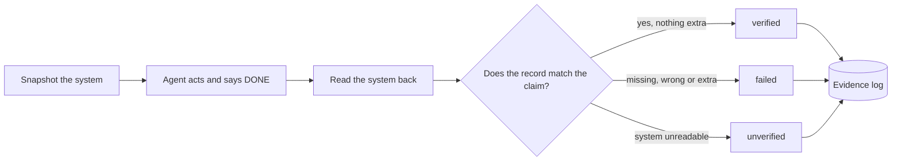

# Readback

**Check what an AI agent says it did against the system of record.**

An agent that books an appointment, issues a refund or updates a database row
usually ends with "Done." That message is a claim, not proof. A tool call can
return success while the record is missing, wrong, or duplicated.

Readback snapshots the real system before the agent acts, reads it again
afterward through a path the agent cannot write to, and returns a verdict.
No LLM is involved in the verdict; every check is a deterministic comparison.



## What it catches

| Problem | Example | Finding |
|---|---|---|
| The write never landed | API answered 201, nothing was stored | `missing` |
| A field is wrong | Appointment saved a day late, refund for the wrong amount | `wrong_value` |
| Something extra happened | Duplicate booking, double refund, unclaimed extra row | `extra_effect` |
| The check could not run | System of record was down | `unreachable` |

## Quick start

```bash
git clone https://github.com/dhonitheja/agent-readback
cd agent-readback
pip install -e ".[dev]"
pytest                     # 35 tests
python -m examples.healthcare.run_eval --provider scripted --runs 200 --inject-faults 0.2
```

The last command runs a scripted scheduling agent that always makes the
correct tool calls, against a mock FHIR server told to mishandle 20% of writes
while still answering "success":

```
Requests:                         200
Agent said DONE:                  200
  verified in the record:         170
  FALSE COMPLETIONS caught:       30  (15.0% of DONE)
Why the false completions failed:
  extra_effect: 7
  missing: 8
  wrong_value: 16
```

The 15% comes from the injected faults. It shows the mechanism working and is
not a measurement of any real agent. A sample of the HTML report is in
[`docs/sample-report.html`](docs/sample-report.html).

## Use it around your own agent

```python
import httpx
from agent_readback import Claim, EvidenceLog, WebhookAlert, watch
from agent_readback.verifiers import FhirAppointmentVerifier

verifier = FhirAppointmentVerifier(httpx.Client(base_url=FHIR_URL, headers=READ_ONLY_AUTH))
log = EvidenceLog("evidence.jsonl")

expected = {"patient": "Patient/123", "practitioner": "Practitioner/7",
            "start": "2027-01-04T15:00:00Z", "status": "booked"}
probe = Claim("fhir.appointment.create", "", expected)

with watch(verifier, probe, log, settle_attempts=3, on_verdict=[WebhookAlert(ALERT_URL)]) as w:
    message = my_agent.book(...)                       # your agent, unchanged
    w.claims(Claim(probe.action, message, expected))

if not w.verdict.ok:
    escalate_to_human(w.verdict)
```

## Verifiers

| Verifier | Actions |
|---|---|
| `FhirAppointmentVerifier` | `fhir.appointment.create`, `.update`, `.cancel` |
| `StripeRefundVerifier` | `stripe.refund.create` |
| `SqlRowVerifier` | `sql.row.insert`, `sql.row.update` |

To add one, implement `snapshot(claim)` and `check(claim, before)` from
[`agent_readback/core.py`](agent_readback/core.py). Give every verifier its own
read-only credentials. If the agent and the verifier share a write path, the
check proves nothing.

## Evidence log

Every verdict is appended to a JSON-lines file in which each record carries
the hash of the one before it, so an edited or deleted record is detectable.

```bash
readback verify-log evidence.jsonl                 # detect tampering
readback report evidence.jsonl                     # verdict counts and failed rate
readback dashboard evidence.jsonl -o report.html   # one-file HTML page
```

By default the log stores no values from the system of record and no agent
text, only field names, match results and a hash of the agent's message. Pass
`keep_fields=["status"]` to keep named fields, or `keep_fields="*"` for
synthetic data.

## Measure a real model

The healthcare example gives an agent scheduling requests in plain English
with Central Time dates. The agent must convert times to UTC and find the
right appointment before changing it. With no injected faults, every false
completion in the result is the model's own.

Keep API keys in your shell environment, never in a committed file.

```bash
export ANTHROPIC_API_KEY=...
python -m examples.healthcare.run_eval --provider anthropic --model claude-haiku-5-5 --runs 100 --out results-haiku.json

export OPENAI_API_KEY=...
python -m examples.healthcare.run_eval --provider openai --model gpt-6-luna --runs 100 --out results-luna.json
```

Add `--fhir-url <base URL>` to run against a real FHIR R4 test server. Only
synthetic patients and practitioners are created.

## Stripe test mode

The Python demo can create a USD 5.00 test payment through Stripe-hosted Checkout
and verify its refund using a separate, restricted API key. The webhook listener
runs on loopback. It verifies the signature against the raw request body and logs
recognized test events without changing payment state. The refund verdict comes
from Stripe's refunds API.

### Install and run the offline tests on Windows

In PowerShell, from the repository root:

```powershell
py -3 -m venv .venv
.\.venv\Scripts\python.exe -m pip install -e ".[dev,stripe-test]"
.\.venv\Scripts\python.exe -m pytest -q tests/test_stripe_test_mode.py tests/test_stripe_mcp.py tests/test_stripe_sql_alerts.py
.\.venv\Scripts\python.exe -m pytest -q
```

### Run the Stripe API smoke test

In the [Stripe Dashboard](https://dashboard.stripe.com/apikeys), select your
test environment. Create two keys in the same environment:

- `STRIPE_TEST_SECRET_KEY` takes a server-side `sk_test_` key or a restricted
  `rk_test_` key with Payment Intents and Refunds write permissions. For the
  Checkout demo, also grant Checkout Sessions write access.
- `STRIPE_TEST_READ_ONLY_KEY` takes a different `rk_test_` key with Payment
  Intents and Refunds read access. Leave its write permissions disabled.

Set the keys in your current PowerShell process with masked prompts. Nothing
loads `.env` automatically. The opt-in test creates and refunds a test payment,
so reruns create additional test records.

```powershell
$env:STRIPE_TEST_SECRET_KEY = [System.Net.NetworkCredential]::new("", (Read-Host "Stripe test write key" -AsSecureString)).Password
$env:STRIPE_TEST_READ_ONLY_KEY = [System.Net.NetworkCredential]::new("", (Read-Host "Stripe restricted test read key" -AsSecureString)).Password
$env:STRIPE_RUN_TEST_MODE = "1"
.\.venv\Scripts\python.exe -m pytest -q --tb=short tests/test_stripe_test_mode.py::test_stripe_api_refund_smoke
Remove-Item Env:STRIPE_RUN_TEST_MODE
```

### Try Checkout and webhooks

1. Install the [Stripe CLI](https://docs.stripe.com/stripe-cli). In a separate
   PowerShell window, run the following commands and keep the listener running.
   Select the same Stripe test environment during login.

   ```powershell
   stripe login
   stripe listen --events checkout.session.completed,refund.created,refund.updated,refund.failed --forward-to http://127.0.0.1:4242/webhook
   ```

2. In another PowerShell window at the repository root, enter the `whsec_`
   signing secret printed by that listener and start the Python receiver.

   ```powershell
   $env:STRIPE_WEBHOOK_SECRET = [System.Net.NetworkCredential]::new("", (Read-Host "Stripe CLI signing secret" -AsSecureString)).Password
   .\.venv\Scripts\python.exe -m agent_readback.stripe_test_mode webhook
   ```

3. In the PowerShell window with both API keys, create a Checkout Session.
   Open the printed Stripe URL and pay with Stripe's test card
   `4242 4242 4242 4242`, a future expiry, and any three-digit CVC.

   ```powershell
   .\.venv\Scripts\python.exe -m agent_readback.stripe_test_mode checkout
   ```

4. Refund the payment using the printed Checkout Session ID.

   ```powershell
   .\.venv\Scripts\python.exe -m agent_readback.stripe_test_mode refund cs_test_REPLACE_WITH_SESSION_ID
   ```

   A successful read-back prints `Refund verification: verified`. The webhook
   terminal logs receipt separately. Use a fresh Checkout Session for each refund run.

### Connect the MCP server

The local stdio MCP server exposes two tools.

| Tool | Behavior |
|---|---|
| `create_test_checkout` | Creates a USD 5.00 test Checkout Session and returns its ID and hosted payment URL. |
| `refund_test_checkout(session_id)` | Refunds a paid test session created by this demo and returns the Stripe read-back status and finding kinds. |

Start the client from an environment that provides the two API keys configured
above. Keep credentials out of the client JSON. For Claude Desktop on Windows,
add the following entry to `%APPDATA%\Claude\claude_desktop_config.json`.
Replace the example path with the absolute path to this repository's virtual
environment. Fully quit and relaunch the client from the PowerShell session
that holds the keys so the server process can inherit them.

```json
{
  "mcpServers": {
    "agent-readback-stripe-test": {
      "command": "C:\\path\\to\\agent-readback\\.venv\\Scripts\\python.exe",
      "args": ["-m", "agent_readback.stripe_mcp"]
    }
  }
}
```

Ask the client to run `create_test_checkout`, open the hosted URL and complete
test payment, then ask the client to run `refund_test_checkout` with that session
ID. Keep the webhook listener running separately if you want to see the event
receipts and local Checkout return pages. The MCP server uses Stripe API
read-back for the verdict.

## Status

Proof of concept, version 0.2. The default test suite runs without external services.

| Part | Tested against | Not yet tested against |
|---|---|---|
| FHIR appointment verifier | in-memory mock FHIR server | a real FHIR server or EHR |
| Stripe refund verifier | mocked Stripe API responses and signed webhook fixtures | real Stripe API run pending (opt-in smoke test above) |
| SQL row verifier | SQLite | Postgres or other databases |
| Anthropic and OpenAI-compatible agent loops | mock responses in each API's message format | the live APIs |

No security or compliance review has been done. Do not point it at real
patient data.

## Roadmap

- Run against a public FHIR sandbox and record a successful Stripe test-mode smoke run
- Publish measured false-completion rates for at least two models
- One-line adapters for LangGraph nodes and additional MCP tool calls

## Project layout

```
agent_readback/        core types, evidence log, report, dashboard, CLI
agent_readback/verifiers/   FHIR, Stripe, SQL
examples/healthcare/   mock FHIR server, agent tools, model providers, evaluation runner
agent_readback/stripe_test_mode.py  Stripe test Checkout, webhooks, and refund read-back
agent_readback/stripe_mcp.py        local MCP server for Stripe test tools
tests/                 unit tests and opt-in Stripe API smoke test
```

## License

MIT. Built by [Sai Teja Ragula](https://github.com/dhonitheja).
