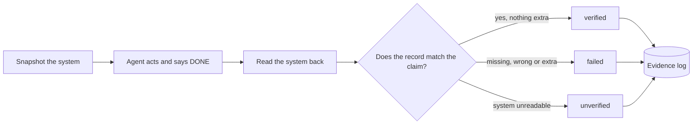

# Readback

[](https://github.com/dhonitheja/agent-readback/actions/workflows/tests.yml)

**Check what an AI agent says it did against the system of record.**

An agent that books an appointment, issues a refund or updates a row usually
ends with "Done." That message is a claim. Readback treats it as one: it
snapshots the real system before the agent acts, reads it again afterward
through a path the agent cannot write to, and returns a verdict.

| Verdict | Meaning |
|---|---|
| `verified` | The system shows exactly what was claimed, with nothing extra. |
| `failed` | The effect is missing, a field is wrong, or something unclaimed also changed. |
| `unverified` | The check could not run. Treat it as an open item, never as success. |

Verdicts never come from an LLM; every check is a deterministic comparison.



## Quick start

Install (Python 3.10+; the only runtime dependency is `httpx`):

```bash
pip install "agent-readback @ git+https://github.com/dhonitheja/agent-readback@v0.3.1"
```

Wrap the call your agent makes. Readback snapshots before it, reads back after
it, and logs the verdict even if the agent raises:

```python
import httpx
from agent_readback import Claim, EvidenceLog, WebhookAlert, watch
from agent_readback.verifiers import FhirAppointmentVerifier

verifier = FhirAppointmentVerifier(httpx.Client(base_url=FHIR_URL, headers=READ_ONLY_AUTH))
log = EvidenceLog("evidence.jsonl")

expected = {"patient": "Patient/123", "practitioner": "Practitioner/7",
            "start": "2027-01-04T15:00:00Z", "status": "booked"}
probe = Claim("fhir.appointment.create", "", expected)

with watch(verifier, probe, log, settle_attempts=3, on_verdict=[WebhookAlert(ALERT_URL)]) as w:
    message = my_agent.book(...)                       # your agent, unchanged
    w.claims(Claim(probe.action, message, expected))

if not w.verdict.ok:
    escalate_to_human(w.verdict)
```

Give the verifier its own read-only credentials. If the agent and the verifier
share a write path, the check proves nothing.

### See it catch false completions

The demo and examples live in the repository, not the installed package:

```bash
git clone https://github.com/dhonitheja/agent-readback && cd agent-readback
pip install -e ".[dev]"
python -m examples.healthcare.run_eval --provider scripted --runs 200 --inject-faults 0.2
```

A scripted agent always makes the correct tool calls, and a mock FHIR server
is told to mishandle 20% of writes while still answering "success":

```
Requests:                         200
Agent said DONE:                  200
  verified in the record:         170
  FALSE COMPLETIONS caught:       30  (15.0% of DONE)
Why the false completions failed:
  extra_effect: 7
  missing: 8
  wrong_value: 16
```

The 15% is produced by the injected faults. It demonstrates the mechanism and
is not a measurement of any real agent.

## What it catches

| Problem | Example | Finding |
|---|---|---|
| The write never landed | API answered 201, nothing was stored | `missing` |
| A field is wrong | Appointment saved a day late, refund for the wrong amount | `wrong_value` |
| Something extra happened | Duplicate booking, double refund, unclaimed extra row | `extra_effect` |
| The check could not run | System of record was down | `unreachable` |
| Not settled yet | Stripe refund matches but the bank has not settled it | `pending` |

| Verifier | Actions | Catches |
|---|---|---|
| `FhirAppointmentVerifier` | `fhir.appointment.create`, `.update`, `.cancel` | never stored, wrong time or practitioner, duplicate booking, wrong appointment changed |
| `StripeRefundVerifier` | `stripe.refund.create` | refund never issued, wrong amount or currency, failed refund, double refund |
| `SqlRowVerifier` | `sql.row.insert`, `sql.row.update` | row absent, wrong column value, unclaimed extra or deleted rows |

To add one, implement `snapshot(claim)` and `check(claim, before)` from
`agent_readback/core.py`.

## Results with real models

Healthcare tasks (book, reschedule, cancel) given in plain English with
Central Time dates; the model converts them to UTC and picks its own tool
calls. 20% of writes were sabotaged by the mock server while it still answered
"success".

| Agent | Harness | Result |
|---|---|---|
| claude-sonnet-5-5, claude-haiku-5-5 | `run_eval`, 50 tasks each | Caught every false completion; matched the scripted baseline run for run |
| gpt-6-luna, `--reasoning-effort none` | `run_eval`, 50 tasks | Caught all 13 injected faults plus 6 of the model's own wrong reschedule or cancel values |
| gpt-6-luna, `--provider openai-responses --reasoning-effort medium` | `run_eval`, 50 tasks | Caught all 13; matched the scripted baseline run for run, with server-side storage and with `--no-store` |
| claude-sonnet-5-5, claude-haiku-5-5, gpt-6-luna | LangGraph agent, 50 tasks each, seed 7 | Same task verdict and finding kinds as `run_eval` and the scripted baseline in every run; all evidence chains intact |

LangGraph outcomes: Haiku and gpt-6-luna 37 `done_and_verified` and 13
`false_completion`; Sonnet 37, 11 and 2 `reported_failure`, because in one run
whose write the verifier failed it reported the failure instead of claiming
DONE. gpt-6-luna ran with LangChain's default reasoning effort. With
`--no-store`, OpenAI echoed `store: false` and encrypted reasoning was sent back
each turn instead of `previous_response_id`. An earlier 3-run LangGraph smoke
test (2026-11-19, 30% faults) gave 2 verified and 1 false DONE caught per
model; too small to compare models.

To run these yourself, see [Measure a real model](#measure-a-real-model).

## Integrations

### One-line adapters: MCP tool calls and LangGraph nodes

`watched()` wraps any sync or async function with the same `watch()` cycle.
`to_claim` gets the call's arguments and returns the claim to check, or `None`
to skip. The result is returned unchanged; verdicts go to `on_verdict`. Neither
MCP nor LangGraph is a dependency.

```python
from agent_readback import Claim, mcp_text, watched

def to_claim(name, arguments=None, *_, **__):
    if name != "book_appointment":
        return None
    return Claim("fhir.appointment.create", "", {**arguments, "status": "booked"})

# MCP: any ClientSession
session.call_tool = watched(session.call_tool, verifier, to_claim, log, said=mcp_text, on_verdict=[alert])

# LangGraph: wrap the node; to_claim receives the node's state
graph.add_node("book", watched(book_node, verifier, lambda s: to_claim("book_appointment", s["booking"]), log))
```

A complete LangGraph agent (agent node + `ToolNode` loop, every write tool
wrapped, plus a task-level check of what was actually requested) is in
`examples/healthcare/langgraph_agent.py`. It needs the `langgraph` extra:

```bash
python -m venv .venv
source .venv/bin/activate          # Windows: .venv\Scripts\activate, or source .venv/Scripts/activate in Git Bash
python -m pip install -e ".[dev,langgraph]"
python -m examples.healthcare.langgraph_agent --runs 20 --inject-faults 0.3   # scripted agent, no API key
python -m examples.healthcare.langgraph_agent --provider anthropic --model claude-haiku-5-5 --runs 10
python -m examples.healthcare.langgraph_agent --provider openai --model gpt-6-luna --runs 10
```

Real models run through `langchain-anthropic` or `langchain-openai`, with keys
from the environment or `.env`.

### Re-checking later: refunds the bank has not settled

A Stripe refund that matches the claim but is still `pending` gives an
`unverified` verdict with a `pending` finding. Keep `verdict.to_dict()` in your
own queue and judge it again once the bank has had time:

```python
from agent_readback import recheck

again = recheck(StripeRefundVerifier(client), stored_dict, log)   # verified, failed, or still pending
```

Only the refunds seen at the first check are judged; refunds created since
then are not counted. The new verdict is logged with `context["recheck_of"]`
set to the first `checked_at`. A verified or failed verdict is never
re-checked. The stored dict holds the observed refund values, so protect the
queue like the system of record itself.

### Rate limiting the verifier's reads

Every verifier reads through the client or `connect` callable you give it, so
the limit goes there. It is opt-in:

```python
from agent_readback import RateLimit, limit_reads

limit = RateLimit(per_second=5, burst=10, max_wait=2.0)   # one limit per quota, shared
fhir = FhirAppointmentVerifier(limit_reads(httpx.Client(...), limit))   # every request, paging included
sql = SqlRowVerifier(limit_reads(connect, limit), "orders", "id")      # every connection
```

- A limit only delays reads, so it never turns a verdict into `failed`.
- With `max_wait`, a read that would wait longer raises `RateLimitTimeout` at
  once instead of stalling the agent; verifiers report it as `unverified`.
  It subclasses `httpx.TimeoutException`, so do not wrap verifier calls in an
  automatic retry-on-timeout: catch `RateLimitTimeout` first and let it stand.
- Limiting the same client or `connect` twice is refused (it would halve the
  rate); share one `RateLimit` across clients instead.
- A 429 the server still sends is a read error, so `unverified`. It is not
  retried.

## Receipts: billed outcomes you can check

Outcome-priced agents bill per "resolution" or "refund issued". A receipt
records whether the system of record shows that outcome, signed so it can be
shared and checked later. Only `verified` receipts are billable, and a Stripe
refund only verifies once Stripe shows it `succeeded`: a pending refund is
`pending` even when the claim said "pending".

| Verdict | Meaning |
|---|---|
| `verified` | The system shows the effect, and no other billed outcome claims it |
| `missing` | Nothing matching the claim exists |
| `contradicted` | Something exists but disagrees (wrong field, failed refund), or the effect already backs another outcome, or was billed in an earlier period |
| `pending` | A matching refund the bank has not settled |
| `unverifiable` | The system could not be read |

A receipt holds no identifiers, amounts, times or agent text: only keyed
digests of the claim, subject, observed state and effect, the read-back query
template, the verdict and finding kinds. It is HMAC-SHA256 signed with
`READBACK_RECEIPT_KEY` (at least 32 bytes, and never the evidence-log or alert
key). There is no unkeyed mode. Outcome ids are stored as a keyed `oid_...`
stand-in unless you pass `--keep-outcome-ids`, since a vendor's references can
hold personal data; your own report still shows the ids you gave.

When someone else must check receipts without being able to make them, also
sign with Ed25519 (`pip install 'agent-readback[signatures]'`). The receipt
then carries `mac_alg: ed25519` and the buyer checks it with your public key
alone:

```bash
openssl genpkey -algorithm ed25519 -out issuer.pem && chmod 600 issuer.pem
openssl pkey -in issuer.pem -pubout -out issuer.pub.pem
readback reconcile november.csv --system stripe --receipts r.jsonl --signing-key issuer.pem
readback verify-receipts r.jsonl --public-key issuer.pub.pem   # no receipt key needed
```

Reconcile a vendor's outcome export against Stripe:

```bash
# Once: make the receipt key and keep it (a secrets manager, or an owner-only file).
python -c "import secrets; print(secrets.token_hex(32))" > receipt.key && chmod 600 receipt.key

# Every period: reuse the same key, or last period's receipts will not verify.
export READBACK_RECEIPT_KEY=$(cat receipt.key)
export READBACK_STRIPE_KEY=rk_...          # restricted key with refunds: read; sk_ keys are refused
readback reconcile november.csv --system stripe --since 2026-11-01 \
    --receipts november-receipts.jsonl --prior october-receipts.jsonl
readback verify-receipts november-receipts.jsonl
```

```
5 billed, 1 verified (20.0%)
  verified 1, missing 2, contradicted 1, pending 1, unverifiable 0
Not verified:
  fin-2  pending  (pending)
  fin-3  contradicted  (wrong_value)
  fin-4  missing  (missing)
  fin-5  missing  (missing)
```

The CSV has `outcome_id`, `action` and the claim's fields (Stripe:
`payment_intent`, `amount` in minor units, `currency`; FHIR: `patient`, and
`id` for update and cancel). JSONL takes one `{"outcome_id", "action",
"expected"}` object per line. If the vendor tags each refund with its outcome
id in Stripe metadata, `--match-metadata KEY` only counts a refund whose
`metadata[KEY]` equals the outcome id, so a refund made for something else
cannot verify the claim. `--system fhir` needs `--base-url` and reads an
optional `READBACK_FHIR_TOKEN`. Secrets come only from the environment. The Stripe key is
only ever sent to `api.stripe.com` (or a localhost stripe-mock), redirects are
never followed, and the command prints which server it reads. Exit
codes: 0 all verified, 1 some not, 2 usage or credentials, 3 bad input file.

At runtime, `receipted()` wraps a tool like `watched()` but raises
`OutcomeNotVerified` unless the receipt is verified, so the agent cannot
report "done" on an outcome the system does not show. In a LangGraph
`ToolNode` the model sees `outcome not verified: missing` as the tool result.

```python
from agent_readback import ReceiptLog, receipted

receipts = ReceiptLog("receipts.jsonl")            # key from READBACK_RECEIPT_KEY
refund = receipted(issue_refund, verifier, to_claim, receipts, log=evidence)
```

Requirements, the threat model and design decisions are in
[`docs/receipts/`](docs/receipts/).

## Evidence log

Every verdict is appended to a JSON-lines file in which each record carries
its sequence number and the hash of the one before it.

```bash
export READBACK_LOG_KEY=...          # same key the log was written with
readback verify-log evidence.jsonl   # detects edited, deleted or reordered records; prints the head hash
readback report evidence.jsonl       # verdict counts and failed rate by action
readback dashboard evidence.jsonl -o report.html   # one-file HTML page; exits 1 if the chain is broken
readback verify-log --require-key evidence.jsonl   # audits: fail unless READBACK_LOG_KEY is set
# exit codes: 0 intact, 1 broken or untrustworthy, 2 bad arguments, 3 file error
```

On Windows the `readback` script may land outside `PATH`; use
`python -m agent_readback` instead. The dashboard shows the same redacted data
as the log, with every value HTML-escaped. A sample is in
[`docs/sample-report.html`](docs/sample-report.html).

- **Keyed hashes.** With `READBACK_LOG_KEY` set (or `EvidenceLog(path, key=...)`)
  every hash is an HMAC-SHA256, so nobody without the key can rewrite the chain
  and pass it off as genuine. Always set it in production.
- **Owner-only, append-only.** The file is created readable by its owner only
  and opened append-only; use one writer per file.
- **Redacted by default.** The log stores no values from the system of record
  and no agent text, only field names, match results and a hash of the agent's
  message. Pass `keep_fields=["status"]` to keep named fields, or
  `keep_fields="*"` for synthetic data. `Claim.context` is stored as given, so
  keep personal data out of it. Decide where the log lives and who can read it
  before pointing Readback at a system that holds personal data.
- **Crashes still leave evidence.** If the agent raises inside the `watch`
  block, the check still runs and the verdict is logged before the exception
  propagates.

### Detecting truncation

Dropping the newest records cannot be seen from the file alone, so anchor the
head outside it. `FileAnchor` rewrites a small file with the record count and
head hash after every append, using the log writer's own permissions. On its
own that file is only as safe as the log: whoever can rewrite the log can
rewrite it too. It catches truncation when the copy you check against is out
of the writer's reach and holds the current head, for example a synced folder
whose version history the writer cannot erase; pass that copy to
`verify-log --anchor`. An older copy, such as a backup, only proves the log
still reaches the head it recorded: records added since can be dropped
undetected. For a stronger anchor, pass any callable `anchor(count, head)` that
appends to an independent append-only store, such as a write-once bucket, a
ticket system or a KMS-signed service. A failed anchor never breaks the agent:
it warns and sets `log.anchor_error`, so monitor that if you rely on the
anchor.

```python
from agent_readback import EvidenceLog, FileAnchor

log = EvidenceLog("evidence.jsonl", anchor=FileAnchor("/secure/readback-head.json"))
```

```bash
readback verify-log evidence.jsonl --anchor /secure/readback-head.json   # BROKEN if newest records were dropped
readback verify-log evidence.jsonl --head <hash from an earlier verify-log>
```

Records added after the anchored head are reported, not rejected. Whoever can
edit both the log and the anchor can still truncate undetected, and without a
key they can also forge new records after the anchored head.

## Security model

What Readback protects: the integrity of the evidence (it is the audit proof),
and the personal or payment data in the systems it reads.

What it assumes: the verifier's credentials are read-only and are not held by
the agent. This is the whole basis of the check. Readback cannot enforce it;
issue the credentials that way (a FHIR client with read scope, a Stripe
restricted key with `refunds: read`, a database role with `SELECT` only).

| Threat | Defence |
|---|---|
| Agent claims success, system disagrees | Independent read-back; verdict is deterministic, never from an LLM |
| Agent crashes after writing | `watch` still checks and logs before the exception propagates |
| Evidence record edited, deleted or reordered | Sequence number + hash chain; `verify-log` reports the first bad record |
| Whole chain rewritten by someone with file access | HMAC-SHA256 with `READBACK_LOG_KEY`; a chain built without the key fails verification (see note 1) |
| Newest records dropped | `EvidenceLog(anchor=FileAnchor(...))` plus `verify-log --anchor FILE` or `--head HASH` reports BROKEN when the anchored head is missing; only as strong as the anchor copy the writer cannot rewrite (see [Detecting truncation](#detecting-truncation)) |
| Personal data in the log | Redacted by default: no observed values, no agent text (keyed digest only), expected values replaced unless named in `keep_fields` |
| Verifier given a key that can also write | `StripeRefundVerifier` refuses a client that sends a Stripe secret key (`sk_live_`, `sk_test_`); use a restricted `rk_` key with refunds read (see note 2) |
| Other Windows accounts reading the log | A new log is restricted to the process's own account before its first record is written (see note 3) |
| Alert spoofing | `WebhookAlert` signs every body with `X-Readback-Signature: sha256=<HMAC>` when `READBACK_ALERT_KEY` is set; receivers must check it |
| Alert receiver forging the log | The alert key is separate from `READBACK_LOG_KEY` and the log key is never used for alerts (see note 4) |
| Server-supplied paging link sends the verifier's token elsewhere | Each FHIR next link is resolved the way httpx will send it (so `//host/x` and similar forms count) and must stay on the client's scheme, host and port; anything else is `unverified` and is never requested |
| Evidence log overwritten by the dashboard | `readback dashboard` refuses an output path that is the log itself or any existing `.jsonl` |
| Hostile or broken server pages forever | FHIR and Stripe reads are page-capped; the result is `unverified`, not a hang |
| Malformed or incomplete server response | The FHIR and Stripe fields the verifiers read are shape-checked where they are parsed (objects, lists, string ids, references and next links); a wrong shape is `unverified`. A read that cannot be completed, such as a FHIR next link with no usable URL or a Stripe page that promises more but is empty, is `unverified`, never `verified`. A Stripe page that repeats stops after the second request. A FHIR search must be a `Bundle` of Appointments that each have an id (`include` and `outcome` entries are skipped), and a Stripe page must carry `data` and `has_more`; anything else is `unverified`. A timestamp with no UTC form is compared as written |
| SQL injection via claim or config | Table and column names come from your code and are pattern-checked; the `placeholder` must be a DB-API paramstyle (`?`, `%s`, `:name`, `:1`, `$1`); values are always bound parameters |
| Verifier overloading the system of record | Opt-in `limit_reads(..., RateLimit(...))` caps every read; it only delays reads, and with `max_wait` an over-long wait is `unverified`, never `failed` (see [Rate limiting the verifier's reads](#rate-limiting-the-verifiers-reads)) |
| Unreadable system of record | `unverified`, never `verified` and never `failed` |
| Receipt forged or edited | HMAC-SHA256 over every field with `READBACK_RECEIPT_KEY` and a domain prefix; `verify-receipts` checks the chain and each receipt, and a receipt cannot be upgraded to `verified` after the read |
| A receipt checker forging receipts | Optional Ed25519 signing (`--signing-key`); `verify-receipts --public-key` needs no secret, and refuses HMAC receipts, which anyone with the shared key could make. The signing key file must be owner-only |
| A refund that only happens to match | `--match-metadata KEY` requires the refund's Stripe metadata to name the outcome |
| One refund or booking billed twice, or again next month | Each effect backs at most one outcome per run; `--prior` receipt logs mark already-billed effects `contradicted`; `--since` ignores refunds from before the period |
| Receipts leaking payment or health data | No identifiers, amounts, times, agent text or Stripe metadata; only keyed digests, finding kinds and field names. Outcome ids become keyed `oid_` stand-ins by default. Errors keep only the exception type, since httpx messages quote URLs that hold ids |
| Receipt log path swapped for a symlink | A symlinked receipt log is refused |
| Receipt key reused for the log or alerts | Refused if shorter than 32 bytes or equal to `READBACK_LOG_KEY`, `READBACK_ALERT_KEY` or any `EvidenceLog` key in the process |
| Hostile outcome export | Size, row, column and cell caps; amounts must be whole numbers; outcome ids must start with a letter or digit (no spreadsheet formulas); errors name the line and field, never the value |
| A claimed FHIR id that walks the URL path (`1/../2`) | Ids must be a valid FHIR id and not only dots, so a read never reaches another resource with the verifier's token |
| Reconciliation writing to the system of record, or sending its key elsewhere | Only GET requests; a Stripe `sk_` key is refused and the Stripe key only goes to `api.stripe.com` or localhost; credentials only from the environment; redirects never followed; plain http only to localhost; reads rate-limited (default 20/s) |

Notes:

1. Without the key, an OK result is labelled `UNKEYED` (not forgery-proof);
   `--require-key` makes audits fail instead. Keyed records carry
   `"mac": "hmac-sha256"`, so a keyed log checked without its key says so
   rather than "edited".
2. The check looks only at the key's prefix, and only for static keys (exactly
   httpx `BasicAuth`, not a subclass, or a Bearer header); custom auth flows are
   never run during the check and their keys are not seen. A prefix cannot
   prove an `rk_` key is read-only.
3. Mode `0600` does nothing on Windows. A new log is created empty, has every
   existing access entry (explicit and inherited) removed with `icacls`, and is
   granted to the SID of the process's own access token, read with `whoami`.
   System32 is located with `GetSystemDirectoryW`; `USERNAME`, `SystemRoot` and
   `PATH` are never used. If that fails the log is still written and a
   `RuntimeWarning` says so. A process that opens the file in the instant
   between creation and restriction keeps its handle, so put logs in a folder
   only you can access. Logs created before this change and anchor files keep
   their folder's access.
4. `WebhookAlert` refuses a key equal to `READBACK_LOG_KEY` or to a key passed
   to any `EvidenceLog` in the same process, at creation and before each send.
   It cannot see keys used only by other processes: keep explicit log and alert
   keys separate yourself.

Known limits: `Claim.context` is stored as given; `Verdict.observed` holds
real values in memory (do not print it in production logs); a pending Stripe
refund is `unverified` until you `recheck` it, and scheduling that is up to
you; rate limiting is opt-in (`limit_reads`) and does not retry a 429. No
external security or compliance review has been done.

## What is tested and what is not

Version 0.3.1 plus unreleased receipts. The suite has 353 offline tests; on Linux
with the optional test dependencies, 348 pass and 5 Windows-only access tests skip. On Windows the symlink test is skipped without symlink privileges. A separate public HAPI FHIR R4 sandbox run verified 10 scripted
operations (6 bookings, 1 reschedule, 3 cancellations); this is a
compatibility smoke test, not production validation. A Stripe test-mode run
produced the expected verdict for all four refund scenarios, using a separate
restricted key that was confirmed unable to create refunds.

| Part | Tested against | Not yet tested against |
|---|---|---|
| FHIR appointment verifier (create, update, cancel) | In-memory mock, incomplete pagination, stale-search regression, off-server next links; injected drop, wrong-time, wrong-practitioner and duplicate faults; public HAPI R4 sandbox smoke test | A production EHR, authenticated read-only isolation |
| Stripe refund verifier and sandbox runner | Mock refunds endpoint; test-key guards; Stripe test mode with a read-only restricted key: success, missing, wrong-amount and duplicate scenarios | Live mode, a refund left pending by the bank |
| SQL row verifier | SQLite, including insert with concurrent deletion | Postgres or any other database |
| Anthropic and OpenAI-compatible agent loops | Mock responses for each API's message format, Responses tool-call chaining with and without storage, a once-per-evaluation warning for a model HTTP 400; live runs in [Results with real models](#results-with-real-models) | Reasoning efforts other than `none` and `medium`; LangGraph with other models |
| `watched()` adapters | Sync and async functions, off-loop verifier reads when an async tool raises, a verdict even when an AnyIO cancel scope cancels the tool after it writes, objects with `async def __call__` | |
| MCP | MCP 1.30 and 2.3 `ClientSession` against in-memory FastMCP, a local stdio subprocess, and the same server over Streamable HTTP on 127.0.0.1, both backed by SQLite; over HTTP a booking the agent misdescribes is `failed` on the field read back from the database | MCP over HTTP to a remote host, with TLS or auth |
| LangGraph | LangGraph 1.2 (CI on Linux and Windows; the `langgraph` extra requires 1.0+): a wrapped `StateGraph` node, a wrapped LangChain tool in `ToolNode`, and a full agent/`ToolNode` loop (`examples/healthcare/langgraph_agent.py`) that catches every false DONE under injected faults | LangGraph 0.x: the two adapter tests passed on 0.2 before 0.2.2, but 0.x is no longer tested and the agent loop needs 1.x |
| Evidence log, redaction, report, dashboard, webhook | Unit tests, including HTML escaping of hostile context values and a BROKEN dashboard for a tampered log | Production load |
| Receipts and reconciliation | Every verdict mapping, MAC tampering of each field, wrong and reused keys, no identifiers in receipts or reports, duplicate and already-billed effects, `--since`, hostile CSV and JSONL, GET-only reads, CLI exit codes; `receipted()` sync, async, in parallel and in a LangGraph `ToolNode`; Ed25519 signing, public-key checks, forged and edited signed receipts; metadata matching; key-host lock and no redirects (mock Stripe and FHIR) | A real vendor export, live Stripe, a real EHR |

No security or compliance review has been done.

## Development

```bash
pip install -e ".[dev]"
pytest
pip install -e ".[security]" && python -m bandit -r agent_readback examples -q && python -m pip_audit --skip-editable
```

### Measure a real model

Keep the key in your shell environment. Do not put it in a file you commit.

```bash
export ANTHROPIC_API_KEY=...
python -m examples.healthcare.run_eval --provider anthropic --model claude-haiku-5-5 --runs 100 --out results-haiku.json

export OPENAI_API_KEY=...
python -m examples.healthcare.run_eval --provider openai --model gpt-6-luna --reasoning-effort none --runs 100 --out results-luna.json
python -m examples.healthcare.run_eval --provider openai-responses --model gpt-6-luna --reasoning-effort medium --runs 100 --out results-luna-reasoning.json
```

Add `--no-store` to the Responses command to send the conversation and
encrypted reasoning with each tool follow-up instead of using stored response
IDs. The agent receives requests in plain English with Central Time dates,
must convert them to UTC, and must find the right appointment before changing
it. With no injected faults, every false completion in the result is the
model's own. Add `--fhir-url <base URL>` to run against a real FHIR R4 test
server; only synthetic patients and practitioners are created.

### Repeat sandbox validation

Run from the repository root with fresh output paths:

```bash
python -m examples.healthcare.run_eval --provider scripted --runs 10 --seed 7 --fhir-url https://hapi.fhir.org/baseR4 --log fhir-evidence.jsonl --out fhir-results.json
python -m examples.stripe_sandbox --log stripe-evidence.jsonl --out stripe-results.json
```

The Stripe runner requires `STRIPE_TEST_SECRET_KEY` (`sk_test_...`) and
`STRIPE_TEST_READ_ONLY_KEY` (`rk_test_...`) in the environment. Configure the
restricted key for refund reads in the same sandbox. Key prefixes identify
test mode, but cannot prove the configured permission scopes. To confirm the
restricted key is read-only, attempt a small refund with it on an existing
test payment: it must return `403 more_permissions_required`. A refund on a
nonexistent payment returns `404` either way and proves nothing. The runner
uses separate clients, refuses live keys, and creates four test payments
with partial refunds to exercise success, missing, wrong-amount, and duplicate
effects. It retains test objects and writes redacted evidence by default.
These are small compatibility checks, not load tests.

The public FHIR sandbox permits anonymous writes, so this check does not
validate credential isolation. Only synthetic records are created and
retained. The initial run exposed cached pre-write searches; the verifier now
requests fresh reads with `Cache-Control: no-cache`. After that change, all
10 operations verified, and the evidence chain was intact.

### Project layout

```
agent_readback/             core types, adapters, evidence log, receipts, reconciliation, rate limiting, report, dashboard, CLI
agent_readback/verifiers/   FHIR, Stripe, SQL
examples/healthcare/        mock FHIR server, agent tools, model providers, evaluation runner, LangGraph agent
examples/stripe_sandbox.py  Stripe test-mode validation runner
tests/                      offline test suite
docs/ROADMAP.md             planned work, by architecture layer
docs/receipts/              receipts requirements, threat model, design, security review
```

## License

MIT
