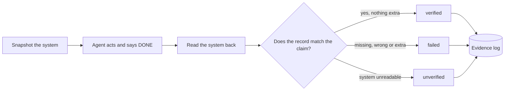

# Readback

**Check what an AI agent says it did against the system of record.**

An agent that books an appointment, issues a refund or updates a database row
usually ends with "Done." That message is a claim, not proof. A tool call can
return success while the record is missing, wrong, or duplicated.

Readback snapshots the real system before the agent acts, reads it again
afterward through a path the agent cannot write to, and returns a verdict.
No LLM is involved in the verdict; every check is a deterministic comparison.



## What it catches

| Problem | Example | Finding |
|---|---|---|
| The write never landed | API answered 201, nothing was stored | `missing` |
| A field is wrong | Appointment saved a day late, refund for the wrong amount | `wrong_value` |
| Something extra happened | Duplicate booking, double refund, unclaimed extra row | `extra_effect` |
| The check could not run | System of record was down | `unreachable` |

## Quick start

```bash
git clone https://github.com/dhonitheja/agent-readback
cd agent-readback
pip install -e ".[dev]"
pytest                     # 35 tests
python -m examples.healthcare.run_eval --provider scripted --runs 200 --inject-faults 0.2
```

The last command runs a scripted scheduling agent that always makes the
correct tool calls, against a mock FHIR server told to mishandle 20% of writes
while still answering "success":

```
Requests:                         200
Agent said DONE:                  200
  verified in the record:         170
  FALSE COMPLETIONS caught:       30  (15.0% of DONE)
Why the false completions failed:
  extra_effect: 7
  missing: 8
  wrong_value: 16
```

The 15% comes from the injected faults. It shows the mechanism working and is
not a measurement of any real agent. A sample of the HTML report is in
[`docs/sample-report.html`](docs/sample-report.html).

## Use it around your own agent

```python
import httpx
from agent_readback import Claim, EvidenceLog, WebhookAlert, watch
from agent_readback.verifiers import FhirAppointmentVerifier

verifier = FhirAppointmentVerifier(httpx.Client(base_url=FHIR_URL, headers=READ_ONLY_AUTH))
log = EvidenceLog("evidence.jsonl")

expected = {"patient": "Patient/123", "practitioner": "Practitioner/7",
            "start": "2027-01-04T15:00:00Z", "status": "booked"}
probe = Claim("fhir.appointment.create", "", expected)

with watch(verifier, probe, log, settle_attempts=3, on_verdict=[WebhookAlert(ALERT_URL)]) as w:
    message = my_agent.book(...)                       # your agent, unchanged
    w.claims(Claim(probe.action, message, expected))

if not w.verdict.ok:
    escalate_to_human(w.verdict)
```

## Verifiers

| Verifier | Actions |
|---|---|
| `FhirAppointmentVerifier` | `fhir.appointment.create`, `.update`, `.cancel` |
| `StripeRefundVerifier` | `stripe.refund.create` |
| `SqlRowVerifier` | `sql.row.insert`, `sql.row.update` |

To add one, implement `snapshot(claim)` and `check(claim, before)` from
[`agent_readback/core.py`](agent_readback/core.py). Give every verifier its own
read-only credentials. If the agent and the verifier share a write path, the
check proves nothing.

## Evidence log

Every verdict is appended to a JSON-lines file in which each record carries
the hash of the one before it, so an edited or deleted record is detectable.

```bash
readback verify-log evidence.jsonl                 # detect tampering
readback report evidence.jsonl                     # verdict counts and failed rate
readback dashboard evidence.jsonl -o report.html   # one-file HTML page
```

By default the log stores no values from the system of record and no agent
text, only field names, match results and a hash of the agent's message. Pass
`keep_fields=["status"]` to keep named fields, or `keep_fields="*"` for
synthetic data.

## Measure a real model

The healthcare example gives an agent scheduling requests in plain English
with Central Time dates. The agent must convert times to UTC and find the
right appointment before changing it. With no injected faults, every false
completion in the result is the model's own.

Keep API keys in your shell environment, never in a committed file.

```bash
export ANTHROPIC_API_KEY=...
python -m examples.healthcare.run_eval --provider anthropic --model claude-haiku-5-5 --runs 100 --out results-haiku.json

export OPENAI_API_KEY=...
python -m examples.healthcare.run_eval --provider openai --model gpt-6-luna --runs 100 --out results-luna.json
```

Add `--fhir-url <base URL>` to run against a real FHIR R4 test server. Only
synthetic patients and practitioners are created.

## Status

Proof of concept, version 0.2. All 35 tests pass, against in-memory stand-ins.

| Part | Tested against | Not yet tested against |
|---|---|---|
| FHIR appointment verifier | in-memory mock FHIR server | a real FHIR server or EHR |
| Stripe refund verifier | mock of the refunds list endpoint | the Stripe API |
| SQL row verifier | SQLite | Postgres or other databases |
| Anthropic and OpenAI-compatible agent loops | mock responses in each API's message format | the live APIs |

No security or compliance review has been done. Do not point it at real
patient data.

## Roadmap

- Run against a public FHIR sandbox and Stripe test mode
- Publish measured false-completion rates for at least two models
- One-line adapters for LangGraph nodes and MCP tool calls

## Project layout

```
agent_readback/        core types, evidence log, report, dashboard, CLI
agent_readback/verifiers/   FHIR, Stripe, SQL
examples/healthcare/   mock FHIR server, agent tools, model providers, evaluation runner
tests/                 35 tests
```

## License

MIT. Built by [Sai Teja Ragula](https://github.com/dhonitheja).
